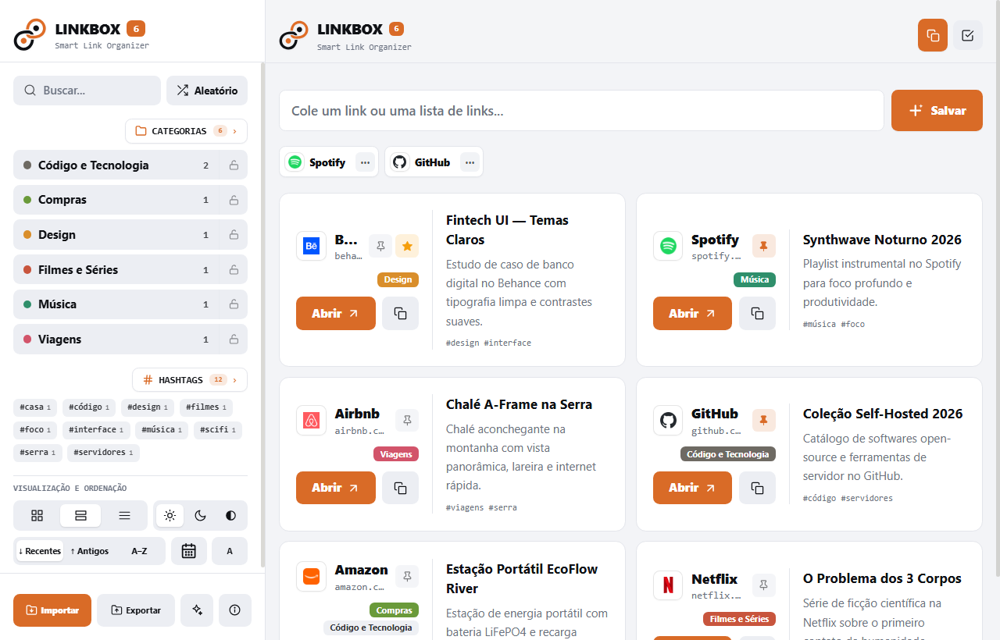
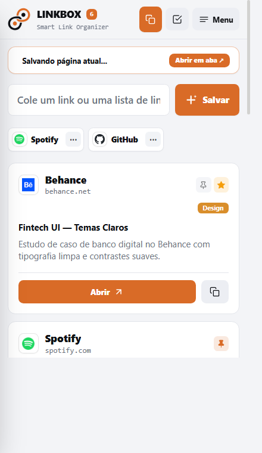

# LinkBox — Organizador Inteligente de Links (PT-BR)

Um organizador de links **100% em Português**, com **design responsivo** (desktop, celular e extensão do Google Chrome), pensado para quem salva links “para ver depois” e quer encontrá-los na hora.

Sem cadastro, sem nuvem obrigatória, sem “entrar com Google”. Os dados ficam salvos localmente no seu navegador/dispositivo.

## Recursos principais

- **Extensão Google Chrome (1 clique para salvar):** clicou no ícone do LinkBox no navegador, a página atual já é salva e categorizada automaticamente.
- **Auto-salvar ao copiar:** com o botão **Auto-copiar** ativo, qualquer link copiado (`Ctrl+C`) em qualquer site (pela extensão) ou colado no app é salvo automaticamente.
- **Categorização inteligente + IA opcional:** regras locais em português classificam links por domínio e conteúdo e aprendem com suas edições. Se quiser, conecte sua chave de API do **Gemini, Groq, Mistral, OpenRouter, DeepSeek, Claude ou OpenAI**.
- **Design responsivo:** barra lateral fixa no desktop, gaveta deslizante no celular, modo compacto no popup da extensão, 3 modos de visualização (Cartões pequenos, Cartões grandes e Lista) e 3 temas (Claro, Escuro e AMOLED).
- **Organização completa:** múltiplas pastas por link, `#hashtags`, barra rápida fixada (Pin-bar), prioridade na pasta, busca instantânea, link aleatório, calendário de atividades, edição em massa, QR Code e bloqueio de abertura direta (modo Cofre / 18+).
- **Offline-first e Backup:** links salvos sem internet ficam na fila **Aguardando rede** e são atualizados quando a conexão volta. Exportação e importação em `.HTML` (favoritos de navegador) e `.JSON` (backup completo).

---

## Como usar a Extensão no Google Chrome

1. Baixe ou clone este repositório.
2. Abra `chrome://extensions/` no Google Chrome.
3. Ative o **Modo do desenvolvedor** (canto superior direito).
4. Clique em **Carregar sem compactação** e selecione a pasta `extension/`.
5. Fixe o ícone do **LinkBox** na barra do Chrome:
   - **Clique no ícone:** salva a página atual na hora e exibe seus links.
   - **Copie um link (`Ctrl+C`) em qualquer site:** o LinkBox captura e salva automaticamente.
   - **Botão direito na página/link:** use *Salvar página no LinkBox* ou *Salvar link no LinkBox*.

## Como usar no Navegador / Celular

Abra o arquivo [index.html](index.html) diretamente no navegador ou hospede como página estática / PWA.
